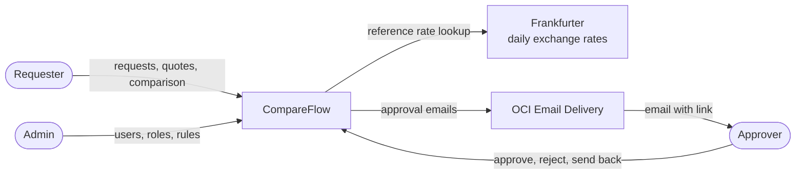
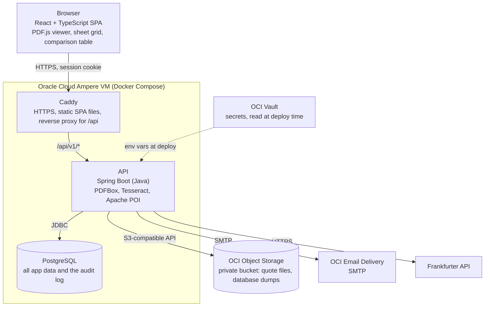
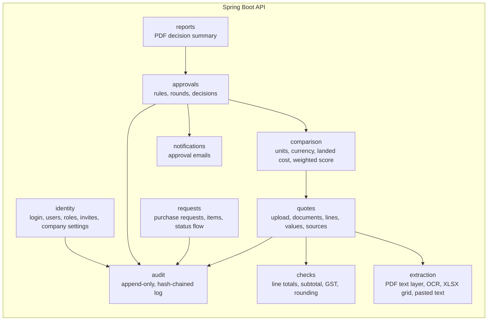
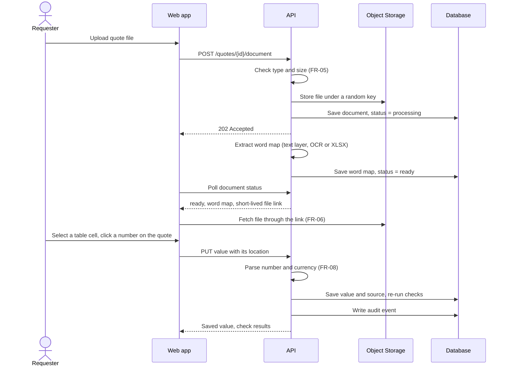
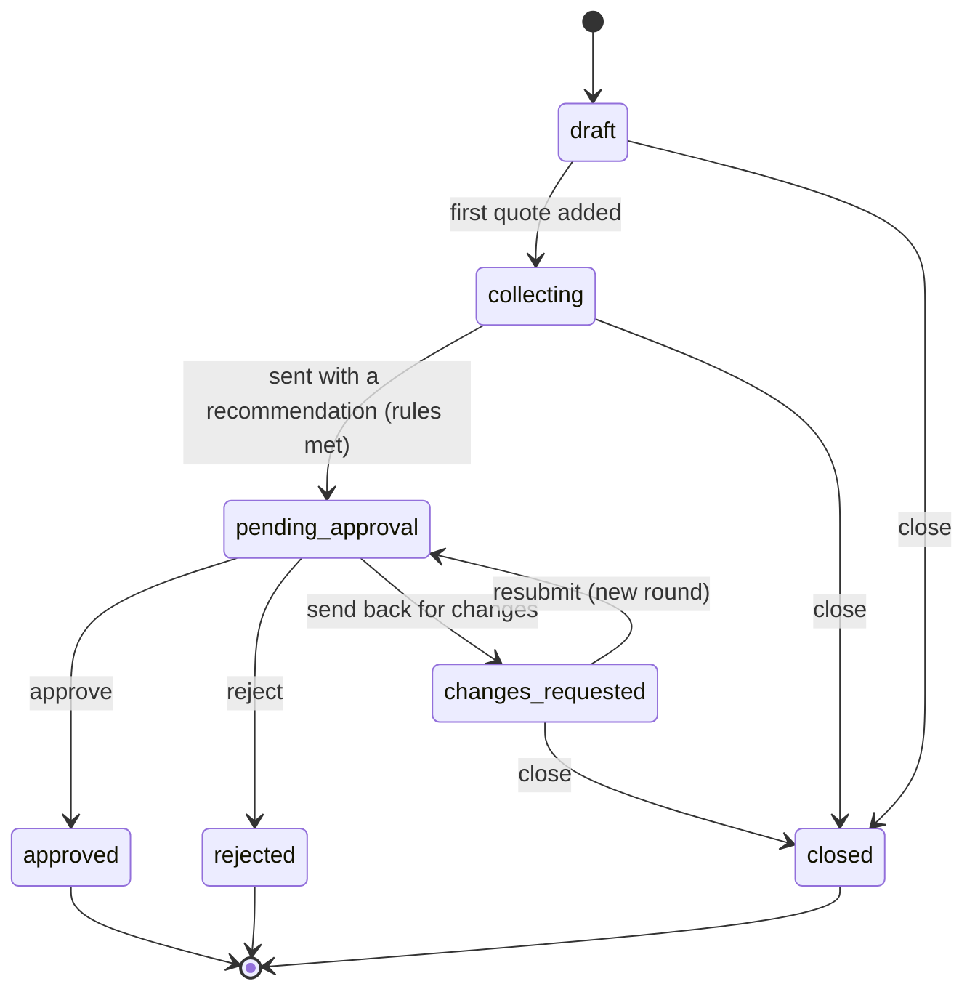
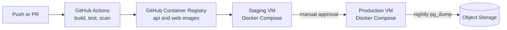

# Architecture

CompareFlow is one React single-page app and one Spring Boot API, with a PostgreSQL database behind it. Caddy serves both on a single hostname per environment. The API is the only part that can reach the database, the quote files, email and secrets. The browser shows quotes and handles clicks, while the server reads quotes, runs the maths checks and enforces the rules, where that code can be tested and trusted.

| Item | Detail |
| --- | --- |
| Version | 1.0 |
| Date | 14 November 2026 |
| Based on | [Requirements v1.0](../requirements/requirements.md), [ADR-0002](../adr/0002-host-on-oracle-cloud-always-free.md) |
| Related | [Data model](data-model.md), ADRs [0004](../adr/0004-spring-boot-modular-monolith.md), [0005](../adr/0005-extract-quote-text-on-the-server.md), [0006](../adr/0006-hash-chained-audit-log.md) |

## System context

Two kinds of people use CompareFlow: staff in a small company (requester, approver, admin) and, through a PDF summary, anyone the company shows a decision to. Suppliers never log in. Their quotes arrive through the requester.

## Containers

Each environment runs on one Ampere VM with Docker Compose. Three containers run on it, and three Oracle Cloud services sit outside it.

| Container | Runs | Responsible for |
| --- | --- | --- |
| Web app | React, TypeScript, Vite build, PDF.js | Screens, the split-screen workspace, drawing click targets over the quote, sending clicked values to the API. Holds no business rules |
| Caddy | Caddy 2 | HTTPS certificates from Let's Encrypt, serving the built SPA, forwarding `/api/v1/*` to the API. One hostname per environment keeps the session cookie same-site |
| API | Java, Spring Boot | Every business rule: auth, company isolation, text extraction, OCR, maths and GST checks, conversion, comparison, approval rules, audit log, email, PDF summary |
| Database | PostgreSQL | All structured data. Schema changes only through Flyway migrations |

Locally, the same Compose file runs with MinIO in place of Object Storage and Mailpit in place of Email Delivery, so no cloud account is needed to develop.

## Inside the API

The API is one deployable app, split into modules by feature (see [ADR-0004](../adr/0004-spring-boot-modular-monolith.md)). A module owns its tables and exposes a service interface. Other modules call that interface and never reach into its tables.

| Module | Stories | Notes |
| --- | --- | --- |
| identity | US-01 | Spring Security with a server-side session (Spring Session JDBC) in an HTTP-only, Secure, SameSite=Lax cookie. Passwords hashed with bcrypt. Login rate-limited |
| requests | US-02 | Owns the request status flow (below) |
| quotes | US-03, US-04, US-05, US-15, US-16 | Stores the quote record, its document, its lines and every filled value with its source |
| extraction | US-03, US-04, US-16 | Turns any quote document into the same word map; see "One path for every quote format" |
| checks | US-07 | Pure functions with no database or web code, so they are easy to unit-test to 80%+ |
| comparison | US-08, US-09, US-17 | Pure functions as well. Exchange rates come from Frankfurter once, then are saved on the quote |
| approvals | US-10, US-11 | Checks the company's rules before sending, records each approval round, blocks self-approval unless allowed |
| audit | US-12 | Every other module writes through it. See [ADR-0006](../adr/0006-hash-chained-audit-log.md) |
| notifications | US-14 | Sends approval emails after the database commit, so a failed email never undoes a decision |
| reports | US-18 | Builds the PDF summary from saved data, not from the screen |

**Company isolation (FR-03, NFR-03).** The company ID comes from the logged-in session, never from the request body or URL. Every repository query on a company-owned table filters by it, and child rows (items, lines, values) are only reached through their parent request or quote. An automated test calls every endpoint as a user from another company and expects a 404.

## One path for every quote format

Every quote document, whatever its format, is turned into the same structure on the server: a **word map** of small pieces of text, each with its location. The browser only ever draws that word map as click targets over the quote, so click-to-fill and source links work the same way for every format. See [ADR-0005](../adr/0005-extract-quote-text-on-the-server.md).

| Format | Read with | Location of each piece | Shown in the browser as |
| --- | --- | --- | --- |
| Text PDF | PDFBox text layer | Page number and box (x, y, width, height) | PDF.js page with boxes drawn over it |
| Scanned PDF or image | Tesseract OCR (after rendering PDF pages to images) | Page number, box and OCR confidence | Page image with boxes drawn over it |
| Excel (XLSX) | Apache POI | Sheet name and cell reference (for example `Quote!D14`) | A grid of the sheet's cells (FR-28) |
| Pasted text | Split into words on the server | Start and end character position | The text with each word clickable (FR-30) |
| No file | Nothing to read | None; every value is "manual" | A note that the quote has no file (FR-26) |

Text PDFs that turn out to have no text layer are sent to OCR instead. OCR runs in a background worker pool, and the browser polls the document's status until it is `ready`. The Week 4 spike checks that one scanned page finishes within 10 seconds on the Ampere VM (NFR-02).

### Filling a value by clicking

## Request status flow

Requirements v1.0 adds "send back for changes" (FR-29). A request is locked once it is approved, rejected or closed.

Each send or resubmit opens a new **approval round** with its own recommendation, reason and decision, so earlier rounds are never overwritten.

## Deployment

Staging and production are the same: one VM each, built from the same images. The full pipeline is designed in Phase 6.

## Quality targets and where they are met

| NFR | Target | Met by |
| --- | --- | --- |
| NFR-01 | API p95 under 300 ms at 50 users | Server-side sessions, indexed company and request IDs, OCR kept off the request thread |
| NFR-02 | Text PDF ready in 3 s, OCR page in 10 s | Text layer read on upload; OCR in a background pool; checked in the Week 4 spike |
| NFR-03 | No cross-company reads | Company ID from the session only, parent-scoped child queries, cross-company tests on every endpoint |
| NFR-04 | bcrypt, HTTPS only, rate-limited login | Spring Security, Caddy HTTPS redirect and HSTS, login limiter |
| NFR-06 | Anonymise users within 30 days | Audit entries hold user IDs, not names or emails, so anonymising the user record leaves them intact |
| NFR-07 | Daily backup, tested restore | Nightly `pg_dump` to Object Storage; restore drill on staging before release |
| NFR-13 | US$0 hosting | Only Always Free services ([ADR-0002](../adr/0002-host-on-oracle-cloud-always-free.md)) |

## Open points for the Week 4 spike

- Tesseract OCR speed and accuracy on the Ampere VM, on clean and poor fake scans.
- PDFBox word boxes lining up with PDF.js rendering at different zoom levels.
- Memory use of the API with OCR running, inside the VM's 6 GB.
