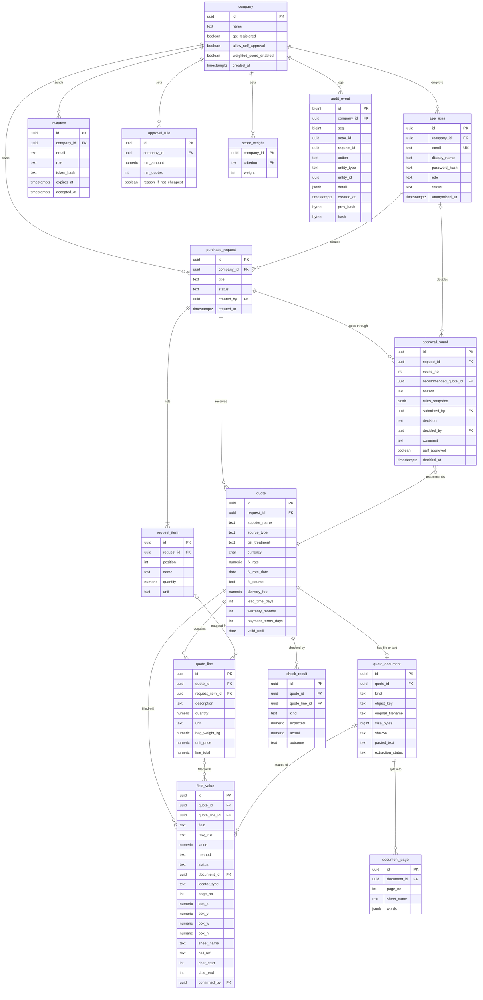

# Data model

CompareFlow stores everything in one PostgreSQL database. A **company** owns its users, rules and purchase requests. A request has the items needed and the quotes received, each quote has lines, and every filled value records where it came from. Approval rounds and the audit log record what happened and who did it.

| Item | Detail |
| --- | --- |
| Version | 1.0 |
| Date | 14 November 2026 |
| Based on | [Requirements v1.0](../requirements/requirements.md), [Architecture](architecture.md) |

## Entity relationship diagram

## Tables

Every table also has `created_at` and, where rows can change, `updated_at`. All IDs are UUIDs except `audit_event`, which uses a sequence so its order is fixed.

| Table | Purpose | Requirements |
| --- | --- | --- |
| `company` | One customer company and its settings: GST-registered, self-approval allowed, weighted score on | FR-03, FR-24, FR-25, FR-31 |
| `app_user` | A person who logs in. `role` is requester, approver or admin. `status` is invited, active or anonymised | FR-01, FR-02, FR-27 |
| `invitation` | A pending invite. Only a hash of the token is stored | FR-02 |
| `approval_rule` | "At least `min_quotes` quotes when the total is `min_amount` or more", plus whether a reason is needed if the choice is not the cheapest | FR-16, FR-17 |
| `score_weight` | One weight per criterion (price, lead time, warranty, payment terms) for the optional weighted score | FR-31 |
| `purchase_request` | What the company wants to buy and where it is in the status flow | FR-04 |
| `request_item` | One needed item: name, quantity and unit | FR-04 |
| `quote` | One supplier's offer for a request: GST treatment, currency and the exchange rate used, delivery fee, terms. `source_type` is file, pasted_text or no_file | FR-14, FR-23, FR-26 |
| `quote_document` | The uploaded file (stored in Object Storage under `object_key`) or the pasted text, plus extraction status | FR-05, FR-06, FR-07, FR-30 |
| `document_page` | The word map for one PDF page or one sheet: each word or cell with its location | FR-07, FR-10, FR-28 |
| `quote_line` | One line on a quote. `request_item_id` links it to the item it is compared against; empty means unmapped | FR-11, FR-13 |
| `field_value` | Every filled value (quantity, unit price, line total, subtotal, GST, total, delivery fee) and where it came from | FR-08, FR-09, FR-21 |
| `check_result` | The latest result of each maths or GST check: pass, note or flag | FR-12 |
| `approval_round` | One send for approval and its outcome. A resubmit after "send back" adds a new round | FR-17, FR-18, FR-25, FR-29 |
| `audit_event` | Append-only, hash-chained record of every action | FR-19, FR-20 |

Spring Session also creates its own `spring_session` tables for login sessions.

## Design choices

**Money and quantities use `numeric`, never floating point.** Unit prices are `numeric(14,4)` and totals `numeric(14,2)`, so a check to S$0.01 is exact. Rounding happens in one place in the `checks` module.

**Values and their sources live in one table.** `field_value` keeps the clicked text (`raw_text`), the parsed number (`value`) and the location together. `locator_type` says which location columns are filled, and a check constraint enforces it:

| `locator_type` | Filled columns | Used for |
| --- | --- | --- |
| `page_box` | `document_id`, `page_no`, `box_x`, `box_y`, `box_w`, `box_h` | Text PDFs and scans |
| `sheet_cell` | `document_id`, `sheet_name`, `cell_ref` | Excel quotes |
| `text_range` | `document_id`, `char_start`, `char_end` | Pasted text |
| `none` | None | Manual values (`method` = manual) |

Separate columns were chosen over one JSON column so the database itself refuses a value with a missing location. The trade-off is some empty columns per row.

**`method` and `status` say how a value got there.** `method` is click, ocr_click, ai_suggested or manual. `status` is suggested or confirmed. Only confirmed values count in checks and comparisons (FR-21), and `confirmed_by` records who confirmed each suggestion. The "100% of values traceable" goal is a query: every confirmed value has either a location or `method` = manual.

**Word maps are JSON per page.** A page can hold hundreds of words that are only ever read together, so `document_page.words` stores them as one `jsonb` array instead of one row per word. Each entry has the text, its box or cell, and OCR confidence where relevant.

**Approval rounds are kept, not overwritten.** `approval_round.rules_snapshot` copies the company rules that applied at the time of sending, so a later rule change never makes an old decision look wrong. `self_approved` marks approvals made under the self-approval override (FR-25).

**Checks are stored as their latest result.** They are re-run whenever a value on the quote changes. Past results are not needed because every value change is already in the audit log.

## Audit log

`audit_event` is the record an auditor relies on, so it is protected in three ways. See [ADR-0006](../adr/0006-hash-chained-audit-log.md).

1. **The app cannot change it.** The database role the API uses has only `INSERT` and `SELECT` on this table, and a trigger rejects any `UPDATE` or `DELETE`, even from the table owner.
2. **Tampering shows.** Each event stores `hash` = SHA-256 of the previous event's hash plus this event's content, in a chain per company. A check walks the chain and reports the first entry that does not match (FR-20).
3. **No personal data inside.** Events store user IDs, never names or emails. Anonymising a user (FR-27) changes only `app_user`, so every audit entry stays valid and the chain stays intact.

Logged actions include request create, edit, send, send-back, resubmit, approve, reject and close; quote and value changes; and admin changes to rules, roles, the self-approval setting, the weighted score and user anonymisation (FR-19). The `detail` field holds the old and new values where something changed.

## Company isolation

`company_id` sits on the top-level tables: `app_user`, `invitation`, `approval_rule`, `score_weight`, `purchase_request` and `audit_event`. Requests carry it down to their items, quotes, lines, values and rounds, which are only ever loaded through their parent. Every query on a top-level table filters by the session's company. Indexes on `company_id` and `request_id` keep those queries fast.

## Migrations

The schema is created and changed only by Flyway migrations in `api/src/main/resources/db/migration`, named `V1__...sql`, `V2__...sql` and so on. A migration is never edited after it is merged; a change is a new migration.
