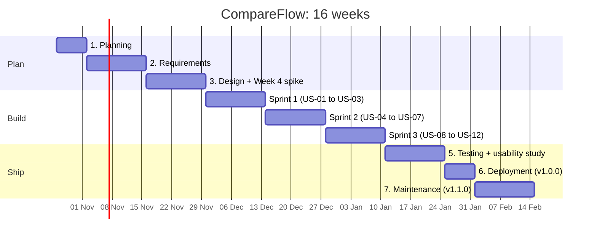

# Phase 1: Planning

| Item | Detail |
| --- | --- |
| Version | 0.1 (draft for review) |
| Date | 29 October 2026 |
| Origin | Concept first pitched by a team of four SP students for the SP Small Project Fund, July 2026 (not funded) |
| This version | Rebuilt and extended by Ethan Yap as an independent project |
| Method | Phased SDLC; 2-week Scrum sprints during the build |

## Problem statement

Small businesses compare supplier quotes by retyping them into Excel, then approve purchases over WhatsApp with no record of why a supplier was chosen. CompareFlow replaces that with one workspace: the quote stays on screen, values are filled by clicking, the maths is checked, and the approval is logged.

**Who has the problem.** Staff who buy supplies often (clinics, F&B outlets, small contractors) and the owner or manager who signs off.

**What goes wrong today.**

1. **Every quote looks different.** Suppliers send PDFs, scans, Excel files and email text, each with its own layout, item names and units.
2. **Retyping causes errors.** Copying prices and quantities into a sheet is slow, and one wrong digit can pick the wrong supplier.
3. **Totals hide the real picture.** Suppliers quote different items, pack sizes, delivery fees, GST treatment and payment terms, so the lowest total is not always the cheapest.
4. **Approvals leave no trail.** A manager says yes on WhatsApp without seeing the other quotes, and nobody can later show why a supplier was chosen.

**What we learned so far.** One interview with a clinic operations manager at SP shaped the product. Fully automatic AI extraction was rejected because every value still had to be checked by hand. The lesson for this version: people need to **trust** each number, so every value must link back to where it came from in the original quote.

**Not yet proven.** How much time is lost per week, and how often errors happen, are assumptions until the Phase 2 interviews and the Phase 5 timed tests measure them.

## Goals and success measures

The project succeeds if real testers compare quotes faster and more accurately than in Excel, and the app runs live in the cloud at no hosting cost, with automated tests and security checks. Targets below are set now and checked in Phase 5.

| Goal | Measure | Target | Checked in |
| --- | --- | --- | --- |
| Faster comparison | Median time to compare 3 quotes, CompareFlow vs Excel | At least 50% faster | Phase 5 timed test, 5-8 testers |
| Fewer errors | Wrong values in the final comparison table | Fewer than in Excel, and every seeded maths error flagged | Phase 5 timed test |
| Trust | Testers who agree "I trust these numbers" (1-5 scale) | Average 4 or higher | Phase 5 survey |
| Easy to use | System Usability Scale score | 70 or higher | Phase 5 survey |
| Quality | Automated tests passing in CI on every merge | 100% pass; core logic 80%+ line coverage | Phase 5 test report |
| Secure | High or critical findings open at release | 0 | CodeQL, ZAP, Trivy reports |
| Live | Production URL with a demo account | Up and monitored | Phase 6 |

**Learning goals (portfolio).** Java Spring Boot API, cloud deployment with Terraform, CI/CD, and running a project through every SDLC phase with documents to show for each.

## Scope (MoSCoW)

The MVP covers the full path from request to approved supplier; exports and invoice matching come only if time allows. Anything under "Won't" is out of scope for this version.

| Priority | Feature |
| --- | --- |
| **Must** | Accounts, one company per account, roles: requester, approver, admin |
| **Must** | Purchase request listing the items needed (name, quantity, unit) |
| **Must** | Upload quotes as text PDF, scanned PDF/image (OCR) and XLSX |
| **Must** | Split-screen workspace: quote on the left, table on the right, click-to-fill |
| **Must** | Every filled value links back to its spot in the quote |
| **Must** | Map each supplier's line items to the requested items |
| **Must** | Maths checks: line total, subtotal, GST |
| **Must** | Unit and currency conversion (kg/tons, USD/SGD) to a common unit price |
| **Must** | Comparison view: per-item and total landed cost (incl. delivery and GST) |
| **Must** | Approval with policy rules (e.g. 3 quotes above S$1,000; reason if not cheapest) |
| **Must** | Audit log that cannot be edited |
| **Should** | AI suggestions for values, which the user must confirm |
| **Should** | Paste email text as a quote |
| **Should** | Weighted score (price, lead time, warranty, payment terms) |
| **Should** | Email notifications for approvals |
| **Should** | PDF summary of the decision |
| **Could** | CSV export for Xero / QuickBooks |
| **Could** | Purchase order PDF from the approved quote |
| **Could** | Match an invoice (sample InvoiceNow/Peppol file) against the approved quote |
| **Won't** | Payments, subscriptions or billing |
| **Won't** | Supplier-side portal (suppliers do not log in) |
| **Won't** | Native mobile app (the web app works on phones) |
| **Won't** | Connection to the real InvoiceNow network |

## Timeline

The project runs 16 weeks part-time: four weeks of planning, requirements and design before any code, three 2-week build sprints, then testing, release and a v1.1. Week 1 starts on Monday 26 October 2026.

| Week | Dates | Phase |
| --- | --- | --- |
| 1 | 26 Oct – 1 Nov 2026 | Planning |
| 2–3 | 2 – 15 Nov | Requirements |
| 4–5 | 16 – 29 Nov | Design (Week 4 spike) |
| 6–7 | 30 Nov – 13 Dec | Sprint 1 |
| 8–9 | 14 – 27 Dec | Sprint 2 |
| 10–11 | 28 Dec 2026 – 10 Jan 2027 | Sprint 3 |
| 12–13 | 11 – 24 Jan 2027 | Testing and usability study |
| 14 | 25 – 31 Jan 2027 | Deployment, v1.0.0 |
| 15–16 | 1 – 14 Feb 2027 | Maintenance, v1.1.0, retrospective |

**Gates:** requirements signed off at the end of week 3; the Week 4 spike proves OCR and the stack; Must-haves done by the end of week 11; v1.0 released in week 14. If a sprint slips, Should and Could items are cut, not the release week.

## Risk register

The biggest risks are time (one person, during a semester) and the hard parts of the build: scanned PDFs and matching items across suppliers. Each has a fallback so the MVP still ships.

| ID | Risk | Likelihood | Impact | Mitigation / fallback |
| --- | --- | --- | --- | --- |
| R1 | Schoolwork and exams squeeze build time | High | High | Must-haves first; cut Should/Could before slipping the release date; 2-week sprints show slippage early |
| R2 | OCR on scanned quotes is unreliable | Medium | Medium | Click-to-fill still works on OCR text; manual entry fallback; test set includes poor scans |
| R3 | Matching line items across suppliers is harder than expected | Medium | High | Start with manual mapping (drag item to request line); add auto-suggest only after it works |
| R4 | Not enough interviewees or testers | Medium | High | Ask early (SP clinic contact, past F&B employers, family businesses); classmates as backup testers |
| R5 | Free-tier limits or terms change, or a charge appears | Low | Medium | Always Free-only account, never upgraded; budget alert at US$1; limits checked again before Phase 6; Terraform makes moving to another host quick |
| R6 | Commercially sensitive data leaks between companies | Low | High | Company ID enforced on every query; automated tests try cross-company access; only fake quotes in demos |
| R7 | New stack (Spring Boot, Terraform) slows progress | Medium | Medium | Small spike in Week 4 to prove the stack; tutorials before Sprint 1 |
| R8 | Original teammates object to a solo version | Low | Medium | Ask them before building; credit them on the portfolio and README |
| R9 | Oracle has no free ARM capacity in Singapore, or reclaims a VM it sees as idle | Medium | Medium | Create both VMs in the Week 4 spike and retry other availability domains; real use and uptime checks keep them above the idle line; Terraform rebuilds a VM and nightly dumps restore its data |

## Cost estimate and feasibility

Hosting costs US$0: every service runs on a free tier, so the only spending is small thank-yous for testers. Limits were checked on 29 Oct 2026 against the providers' pages and are checked again before Phase 6. See [ADR-0002](../adr/0002-host-on-oracle-cloud-always-free.md) for why.

| Item | Choice | Free limit | Cost |
| --- | --- | --- | --- |
| API, database and web server | Oracle Cloud Always Free: two Ampere A1 VMs (staging and production, 1 OCPU and 6 GB each) running Docker Compose with Caddy, Spring Boot and PostgreSQL | 2 OCPUs and 12 GB memory in total; 200 GB block storage | US$0 |
| Quote files and database dumps | OCI Object Storage, private bucket | 20 GB; 50,000 requests a month | US$0 |
| Email | OCI Email Delivery | 3,000 emails a month | US$0 |
| Secrets | OCI Vault + GitHub environment secrets | 150 secrets | US$0 |
| HTTPS and domain | Caddy with Let's Encrypt on a free DuckDNS subdomain | Free | US$0 |
| Container images | GitHub Container Registry | Free for public images | US$0 |
| Code, CI, project board | GitHub + GitHub Actions | Free on public repos | US$0 |
| Monitoring | OCI Monitoring and Notifications, UptimeRobot, Sentry | Free plans | US$0 |
| OCR | Tesseract | Open source | US$0 |
| Design | Figma (education plan) | Free | US$0 |
| Tester incentives | Kopi or snacks, not vouchers | | Under S$50 total |

**Running total:** US$0 a month. Oracle asks for a card to verify the account, but an Always Free-only account is not charged unless it is upgraded, and a budget alert at US$1 catches any slip. The two VMs use the whole free compute allowance, so there is no room for a third environment.

**Technical feasibility:** every Must-have uses well-documented tools (PDF.js for the text layer, Tesseract for OCR, Spring Boot, PostgreSQL). The riskiest pieces, OCR quality and item matching, are tested in a Week 4 spike before the build starts.

Sources: [Oracle Always Free resources](https://docs.oracle.com/en-us/iaas/Content/FreeTier/freetier_topic-Always_Free_Resources.htm), [DuckDNS](https://www.duckdns.org/).

## Phase 1 exit checklist

- [x] Problem statement, goals, scope, timeline, risks and cost estimate (v0.1)
- [ ] OK from the original pitch team for a solo version, and agreed credit
